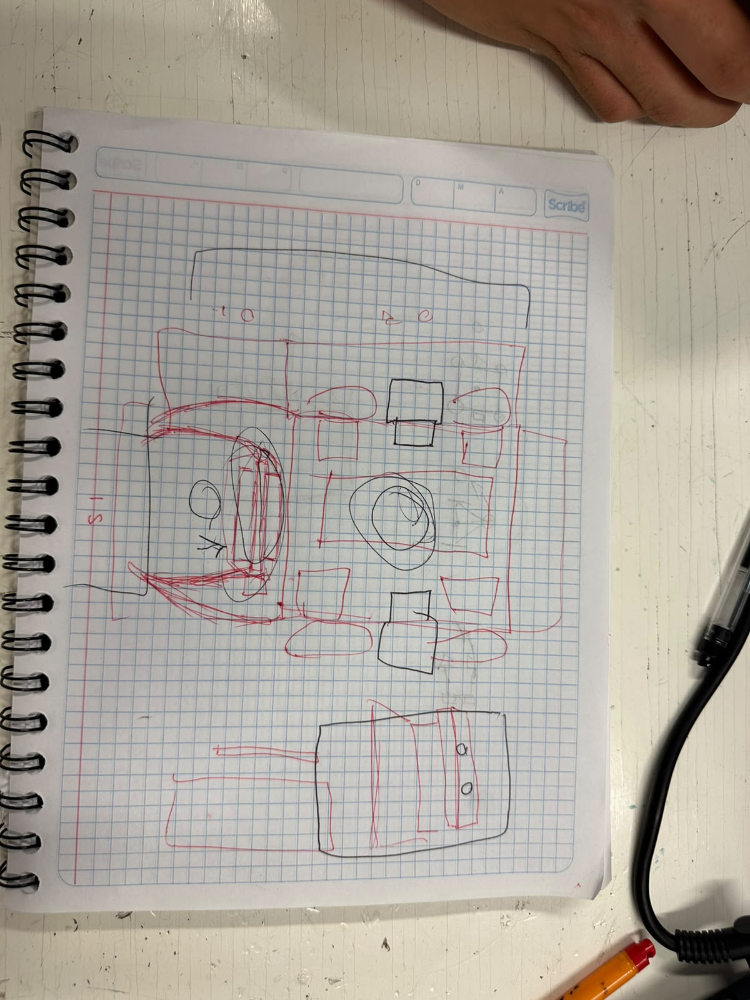

# Sesion 6 de Mecatrónica (25 de septiembre de 2026)
Hoy como tal no hubo clase, más bien, se nos dió una introducción del proyecto a realizar, el cual es un futbol de coches creados por nosotros y controlados via bluetooth.

Despúes de armar el equipo, emepzamos todos a hacer una lluvia de ideas de que hacer para el coche. No importa que tan locas o imposibles eran, era una lluvia de ideas.

Despúes, nos dedicamos a elegir que cosa haría cada quien en el coche, cosa que me termino dejando a mí como el encargado del código de este mismo.

Por último, de todas las ideas que hicimos, empezamos a descartar las ideas dificiles de implementar o las inútiles, para posteriormente terminar con lo que sentimos nosotros que si serviría.

Esa fue básicamente la sesión del día de hoy, algo inútil y pequeño el avanze que hicímos, pero por algo se empieza, no?