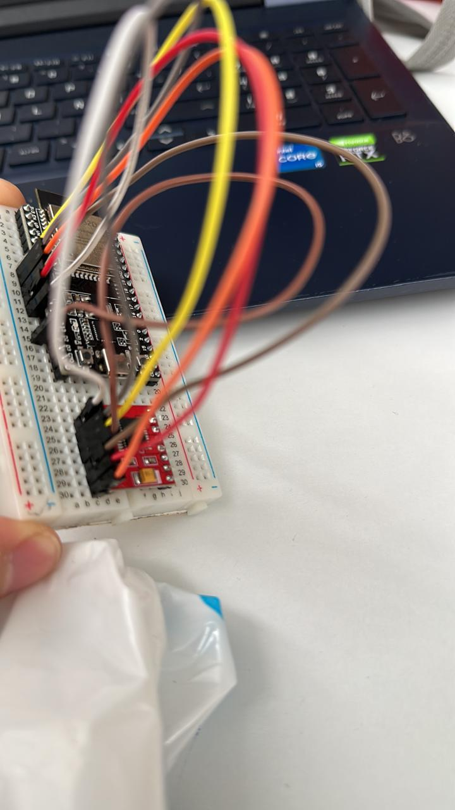
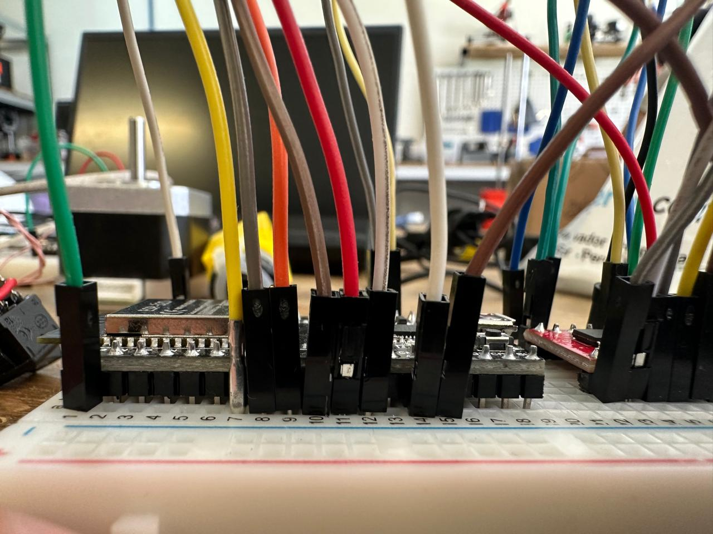
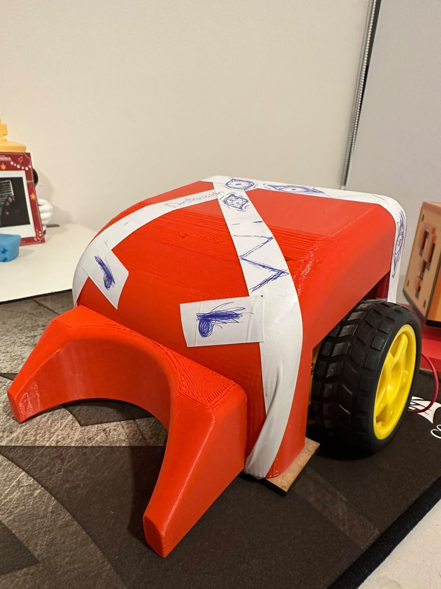

# Sesión número 8 de Mecatrónica/ Construcción del carro RC
Hoy oliver no dio clase. Sin embargo, nos dió la clase para volver a organizarnos para realizar nuestro proyecto
Quedamos que mi equipo haría el chasis y la base, cosa que todavía no habían hecho. Por mi parte, aproveche de terminar de soldar algunas cosas que todavía no funcionaban en mi circuito, como el puente H. Oliver, muy amablemente me enseño a soldar por primera vez, y me quedo bastante bien soldado el puente H.

### Circuíto

Aunque no fue dentro de la sesión, creo que debería hablar acerca de la construcción del proyecto.

El circuito fue algo sencillo. Yo lo hice, y como ya había hecho varios proyectos con motores, se me facilitó bastante la coneccion del puente H, junto con los motores y el arduino, que en este caso, era un ESP32.





obviamente ahí, no se logra con claridad el funcionamineto del circuito, pero se alcanza a dar una idea.

### Código

Posteriormente, me dedique a hacer el código. Fue algo muy muy tedioso diría yo. Le pedí algo de ayuda a la IA, principalmente con el monitor serial, para yo poder hacer pruebas de que señal estaba mandando, y poder tradudcirlo a una app que encontre en la playstore para controlar vehiculos bluetooth.
También le pedí ayuda con 2 cosas, la primera, el dar curvas. Puede que sea algo "FACIL", sin embargo, me costo bastante lograrlo. Se supone que, al momento de dar una curva, una rueda va mas lenta que otra y ya. Pero al intentar replicar eso en mi código, no funcionaba. Cosa que termino arreglando la IA, pues al parecer estaba escribiendo MAL algunas variables.

Por último, le pedí ayuda con un requerimiento que estaba en la rúbrica del proyecto, el cual consistia en que, al momento de mandar una señal, pero no se detectara una respuesta, se desconectara automáticamente del Carro.
En lo personal, no tenía ni IDEA de como realizar eso. Intente que la IA me explicara más o menos como hacerlo, pero no entendí con exactitud como funcionaba. 
Aquí esta el código que quedó al final:

```

#include "BluetoothSerial.h"
BluetoothSerial BT;

// Pines ESP32 -> TB6612
const int AIN1 = 26, AIN2 = 27, PWMA = 25;  // Motor izquierdo
const int BIN1 = 32, BIN2 = 33, PWMB = 14;  // Motor derecho
const int STBY = 13;

int velocidad = 170;  
char movimiento = 'S';     

void pwm(int pin, int valor) {
#if ESP_ARDUINO_VERSION_MAJOR >= 3
  ledcWrite(pin, valor);
#else
  ledcWrite(pin == PWMA ? 0 : 1, valor);
#endif
}

// Curvitas
void motores(int a1, int a2, int b1, int b2, int velA, int velB) {
  digitalWrite(AIN1, a1);
  digitalWrite(AIN2, a2);
  digitalWrite(BIN1, b1);
  digitalWrite(BIN2, b2);
  pwm(PWMA, velA);
  pwm(PWMB, velB);
}
// Dirrecciones
void adelante()  { motores(HIGH, LOW, HIGH, LOW, velocidad, velocidad); }
void atras()     { motores(LOW, HIGH, LOW, HIGH, velocidad, velocidad); }
void derecha()   { motores(HIGH, LOW, LOW, HIGH, velocidad, velocidad); }
void izquierda() { motores(LOW, HIGH, HIGH, LOW, velocidad, velocidad); }
void alto()      { motores(LOW, LOW, LOW, LOW, 0, 0); }

// Curvas
void adelanteIzq() { motores(HIGH, LOW, HIGH, LOW, velocidad / 2, velocidad); }
void adelanteDer() { motores(HIGH, LOW, HIGH, LOW, velocidad, velocidad / 2); }
void atrasIzq()    { motores(LOW, HIGH, LOW, HIGH, velocidad / 2, velocidad); }
void atrasDer()    { motores(LOW, HIGH, LOW, HIGH, velocidad, velocidad / 2); }

void ejecutar(char m) {
  movimiento = m;
  switch (m) {
    case 'F': adelante();     break;
    case 'B': atras();        break;
    case 'L': izquierda();    break;
    case 'R': derecha();      break;
    case 'G': adelanteIzq();  break;   
    case 'H': adelanteDer();  break;   
    case 'I': atrasDer();     break;   
    case 'J': atrasIzq();     break;   
    default:  alto(); movimiento = 'S'; break;
  }
}

void setup() {
  Serial.begin(115200);                    // Monitor Serie (115200 baud)
  BT.begin("CarroRC_ATOM");

  int pines[] = {AIN1, AIN2, BIN1, BIN2, STBY};
  for (int p : pines) pinMode(p, OUTPUT);
  digitalWrite(STBY, HIGH);

#if ESP_ARDUINO_VERSION_MAJOR >= 3
  ledcAttach(PWMA, 1000, 8);
  ledcAttach(PWMB, 1000, 8);
#else
  ledcSetup(0, 1000, 8); ledcAttachPin(PWMA, 0);
  ledcSetup(1, 1000, 8); ledcAttachPin(PWMB, 1);
#endif
  alto();
}

void loop() {
  if (BT.available()) {
    char c = BT.read();

    if (c != '\r' && c != '\n') {          // ignora saltos de linea
      Serial.print("Recibido: ");          // para pruebas
      Serial.println(c);
    }

    if (c >= '0' && c <= '9') {            
      velocidad = map(c - '0', 0, 9, 90, 255);
      ejecutar(movimiento);                
    }
    else if (c == 'q') {                   
      velocidad = 255;
      ejecutar(movimiento);
    }
    else if (c != '\0' && strchr("FBLRGHIJS", c)) {   // movimientos y alto
      ejecutar(c);
    }
  }

  // Failsafe: si se pierde la conexion, alto
  if (!BT.hasClient()) alto();
}
```
*Recalco que todo esto lo hice UNICAMENTE, en arduino. Por si a caso*

### Chasis
Probablemente, la parte mas estresante y tardía del proyecto.
Mi equipo, desgraciadamente 3 días antes, no habían hecho ni si quiera la base, lo cual atraso demasiado la consturccion del coche. Afortunadamente, al final del día, me dieron una placa de MDF cortada a laser para poder ahí colocar todo el circuito y motores.

Paralelamente, un integrante de mi equipo había impreso unas piezas que nos iba a permitir colocar las ruedas de tal amnera, que la altura de estas fuera ajustable. Impresión que tenpia vaarios problemas, y medidas erroneas, por lo que un integrante de otro equipo tuvo que regalarnos un diseño que el tenía para estas. Lastimosamente, esta no tenía uan amnera de ajustar la altura, pero no podíamos quejarnos.

### Chasis
Despues de finalmente tener el esqueleto, y la base, (despues de bastantes bloopers), Un compañero termino diseñando el chasis para poder tener algo para empujar la pelota. Quedo INCREÍBLE, almenos para el poco tiempo que teníamos para terminar nuestro coche. Como me encontraba bastante cansado, termine diciendole a el que terminara de pegar el chasis. Cosa que termino realizando con cinta de aislar.
Despúes, unos amigos terminaron de dibujarle cosas al azar. Terminando nuestro coche "Atom"



*El nombre es en honor a la película Gigantes de acero, debido a que se construyo en su mayoría con piezaas que sobraron de otro robot que yo tenía.*